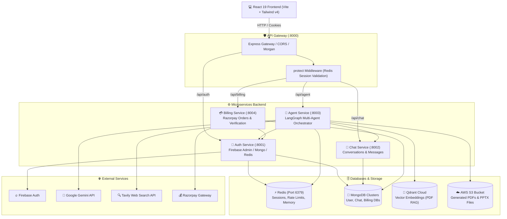
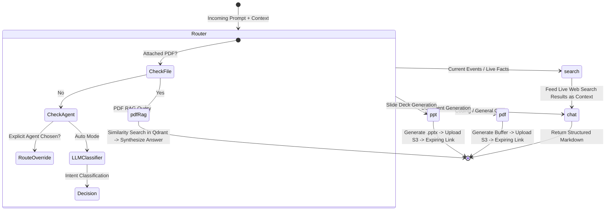

# 🧠 CortexAI - Multi-Agent AI Chatbot & Productivity Platform

[](https://react.dev/)
[](https://nodejs.org/)
[](https://expressjs.com/)
[](https://langchain.com/)
[](https://deepmind.google/technologies/gemini/)
[](https://qdrant.tech/)
[](https://redis.io/)
[](https://www.mongodb.com/)
[](https://aws.amazon.com/s3/)
[](https://razorpay.com/)

> **CortexAI** is a production-grade, distributed multi-agent conversational AI and productivity platform. Built on an enterprise microservices architecture and powered by **LangGraph**, **Google Gemini**, **Qdrant Vector DB**, and **Redis**, CortexAI intelligently routes user queries to specialized autonomous agents for coding, real-time web research, instant PDF/PowerPoint generation, and PDF document RAG analysis.

---

## 📑 Table of Contents

- [Overview](#-overview)
- [Key Features & Agent Fleet](#-key-features--agent-fleet)
- [System Architecture](#-system-architecture)
- [Multi-Agent LangGraph Workflow](#-multi-agent-langgraph-workflow)
- [Credit & Rate-Limiting Engine](#-credit--rate-limiting-engine)
- [Tech Stack](#-tech-stack)
- [Project Directory Structure](#-project-directory-structure)
- [Environment Variables](#-environment-variables)
- [Getting Started & Local Setup](#-getting-started--local-setup)
- [API Gateway Reference](#-api-gateway-reference)
- [Subscription & Billing Tiers](#-subscription--billing-tiers)
- [Contributing & License](#-contributing--license)

---

## 🌟 Overview

Modern knowledge workers and developers constantly switch between disparate tools for coding, searching current facts, compiling slide decks, generating documents, and summarizing long PDFs.

**CortexAI** unifies these tasks under a single conversational interface driven by an autonomous multi-agent backend:
1. **Intelligent Router**: Analyzes user intent via an LLM classifier and dispatches queries to the optimal agent node automatically, or respects manual agent overrides.
2. **Microservices Scalability**: Decoupled services (Gateway, Auth, Agent, Chat, Billing) communicating over HTTP and Redis distributed state.
3. **Enterprise Storage & RAG**: Cloud-backed PDF and PowerPoint exports stored in AWS S3 with presigned 24-hour expiration links, alongside high-performance vector search in Qdrant for PDF document analysis.
4. **Subscription & Credit Control**: Built-in tiered billing with Razorpay, granular credit deductions per capability, and sliding-window Redis rate limiters.

---

## 🤖 Key Features & Agent Fleet

| Agent | Trigger Mode | Technology | Description |
|---|---|---|---|
| 💬 **Chat & Code Agent** | Auto / Manual (`chat`) | Google Gemini (`gemini-2.5-flash`), LangChain Memory | Production-grade software engineering, algorithm dry-runs, Big-O complexity analysis, script generation, and conversational Q&A. |
| 🌐 **Web Search Agent** | Auto / Manual (`search`) | Tavily Search API, Gemini Flash | Live internet scraping for real-time news, scores, facts, and image searches, seamlessly synthesized into coherent responses. |
| 📄 **PDF Generator** | Auto / Manual (`pdf`) | PDFKit, AWS S3 SDK | Generates structured, professional multi-page PDF documents and provides a secure, expiring presigned AWS S3 download link. |
| 📊 **Presentation (PPT) Agent** | Auto / Manual (`ppt`) | PptxGenJS, AWS S3 SDK | Crafts professional, styled Microsoft PowerPoint presentations (`.pptx`) uploaded directly to AWS S3 with instant download links. |
| 📑 **PDF RAG Agent** | File Upload (`pdfRag`) | `pdf-parse`, LangChain TextSplitters, Qdrant Vector Store | Extracts text from uploaded PDFs, chunks and embeds vectors into Qdrant, and runs semantic similarity searches for precise Q&A. |

---

## 🏗 System Architecture

CortexAI follows a microservices pattern with an API Gateway acting as the single reverse proxy for client requests.



---

## 🔄 Multi-Agent LangGraph Workflow

User requests dispatched to the **Agent Service** pass through a compiled LangGraph `StateGraph`:



---

## ⚡ Credit & Rate-Limiting Engine

CortexAI implements a fair-use protection mechanism and monetization system:

### 1. Granular Credit Deductions
Credits are debited per successful agent dispatch from the user's balance:
- **Chat**: `1 Credit`
- **Web Search**: `5 Credits`
- **Coding Solutions**: `10 Credits`
- **PDF Generation**: `10 Credits`
- **PPT Presentation Generation**: `10 Credits`
- **PDF RAG Analysis**: `10 Credits`

### 2. Sliding-Window Redis Rate Limiter
To prevent abuse, each agent endpoint enforces rolling 60-second execution quotas:
- **Chat**: 20 requests / min
- **Web Search**: 5 requests / min
- **Code Generation**: 5 requests / min
- **PDF Generation**: 2 requests / min
- **PPT Generation**: 5 requests / min

---

## 🛠 Tech Stack

### Frontend
- **Framework**: React 19, Vite 8
- **Styling**: Tailwind CSS v4, Lucide React icons
- **State Management**: Redux Toolkit (`@reduxjs/toolkit`, `react-redux`)
- **Animation**: Motion (`motion/react`)
- **Rendering & Syntax**: `react-markdown`, `remark-gfm`, `react-syntax-highlighter`
- **Authentication**: Firebase Client SDK
- **Payments**: Razorpay Checkout SDK

### Backend & Microservices
- **Runtime**: Node.js (ES Modules)
- **Framework**: Express.js 5.x
- **Reverse Proxy**: `express-http-proxy`
- **Agent Framework**: LangChain (`@langchain/core`, `@langchain/google-genai`, `@langchain/langgraph`)
- **Vector Database**: `@langchain/qdrant` & Qdrant Cloud
- **Document & Presentation Builders**: `pdfkit`, `pdf-parse`, `pptxgenjs`
- **Cloud Storage**: AWS SDK v3 (`@aws-sdk/client-s3`, `@aws-sdk/s3-request-presigner`)
- **Web Search**: `@langchain/tavily`
- **Databases**: MongoDB (Mongoose), Redis (`ioredis`)
- **Payments**: Razorpay Node SDK

---

## 📂 Project Directory Structure

```text
CortexAI/
├── backend/
│   ├── docker-compose.yml          # Redis container orchestration
│   ├── package.json                # Root backend dependencies
│   ├── gateway/                    # API Gateway (Port 8000)
│   │   ├── controllers/            # User profile controllers
│   │   ├── middleware/             # Redis session authentication middleware
│   │   ├── utils/                  # Proxy headers utility
│   │   ├── index.js                # Express Gateway entrypoint
│   │   └── Dockerfile
│   ├── services/
│   │   ├── auth/                   # Authentication Service (Port 8001)
│   │   │   ├── config/             # Firebase Admin & MongoDB configs
│   │   │   ├── controllers/        # Login, logout, credit deduction
│   │   │   ├── models/             # Mongoose User schema
│   │   │   └── routes/             # Auth routes
│   │   ├── chat/                   # Conversation Service (Port 8002)
│   │   │   ├── config/             # MongoDB connection
│   │   │   ├── controllers/        # Conversation & message history logic
│   │   │   ├── models/             # Conversation and Message schemas
│   │   │   └── routes/             # Chat persistence routes
│   │   ├── agent/                  # Multi-Agent LangGraph Service (Port 8003)
│   │   │   ├── agents/             # Chat, Search, PDF, PPT, and PDF-RAG agents
│   │   │   ├── config/             # Gemini LLMs, Qdrant, S3, Memory, Rate Limits
│   │   │   ├── controllers/        # Agent invocation controller
│   │   │   ├── graph/              # LangGraph workflow, state, and router
│   │   │   ├── routes/             # Agent execution routes
│   │   │   └── utils/              # PDF/PPT builders, S3 uploaders, credit callers
│   │   └── billing/                # Billing & Payments Service (Port 8004)
│   │       ├── config/             # Razorpay configuration
│   │       ├── controllers/        # Order creation & payment verification
│   │       ├── models/             # Transaction / Order schemas
│   │       └── routes/             # Billing routes
│   └── shared/
│       └── redis/                  # Shared Redis connection client
│
└── frontend/                       # React 19 + Vite Application (Port 5173)
    ├── src/
    │   ├── components/             # ChatArea, ChatInput, MessageBubble, SideBar, BillingDrawer
    │   ├── features/               # API interaction hooks & async thunks
    │   ├── pages/                  # Home main chat screen
    │   ├── redux/                  # Redux slices (conversations, messages, user)
    │   ├── App.jsx                 # Main application component
    │   └── main.jsx                # Application root
    ├── index.html
    └── vite.config.js
```

---

## 🔐 Environment Variables

Ensure that each service has its corresponding `.env` file configured.

### 1. API Gateway (`backend/gateway/.env`)
```env
PORT=8000
AUTH_SERVICE=http://localhost:8001
CHAT_SERVICE=http://localhost:8002
AGENT_SERVICE=http://localhost:8003
BILLING_SERVICE=http://localhost:8004
FRONTEND_URL=http://localhost:5173
REDIS_URL=redis://localhost:6379
```

### 2. Auth Service (`backend/services/auth/.env`)
```env
PORT=8001
MONGO_URI=mongodb+srv://<username>:<password>@cluster.mongodb.net/auth
FRONTEND_URL=http://localhost:5173
REDIS_URL=redis://localhost:6379
```
*(Requires `serviceAccountKey.json` for Firebase Admin SDK in `backend/services/auth/`)*

### 3. Chat Service (`backend/services/chat/.env`)
```env
PORT=8002
MONGO_URI=mongodb+srv://<username>:<password>@cluster.mongodb.net/chat
```

### 4. Agent Service (`backend/services/agent/.env`)
```env
PORT=8003
MONGO_URI=mongodb+srv://<username>:<password>@cluster.mongodb.net/agent
AUTH_SERVICE=http://localhost:8001
CHAT_SERVICE=http://localhost:8002
REDIS_URL=redis://localhost:6379

GOOGLE_API_KEY=your_google_gemini_api_key
GEMINI_MODEL=gemini-2.5-flash
TAVILY_API_KEY=your_tavily_search_api_key

# AWS S3 for PDF/PPT Document Storage
AWS_REGION=us-east-1
AWS_ACCESS_KEY_ID=your_aws_access_key
AWS_SECRET_KEY=your_aws_secret_key
AWS_BUCKET_NAME=your_s3_bucket_name

# Qdrant Vector Database for PDF RAG
QDRANT_API_KEY=your_qdrant_api_key
QDRANT_URL=https://your-cluster-url.qdrant.io
```

### 5. Billing Service (`backend/services/billing/.env`)
```env
PORT=8004
MONGO_URI=mongodb+srv://<username>:<password>@cluster.mongodb.net/billing
AUTH_SERVICE=http://localhost:8001
RAZORPAY_KEY_ID=your_razorpay_key_id
RAZORPAY_KEY_SECRET=your_razorpay_secret
```

### 6. Frontend (`frontend/.env`)
```env
VITE_SERVER_URL=http://localhost:8000
VITE_FIREBASE_API_KEY=your_firebase_web_api_key
VITE_RAZORPAY_KEY_ID=your_razorpay_key_id
```

---

## 🚀 Getting Started & Local Setup

### 1. Prerequisites
- **Node.js**: v18.0.0 or higher
- **npm** or **pnpm**
- **Docker**: For running Redis locally
- **MongoDB Atlas** or a local MongoDB instance
- **Firebase Project**: Configured for Google/Email authentication
- **Qdrant Cloud** instance
- **AWS S3 Bucket** with PutObject/GetObject permissions

### 2. Start Redis
From `backend/`:
```bash
docker compose up -d redis
```

### 3. Install Dependencies & Run Microservices

You can launch each service in its own terminal tab:

#### 🛡 Gateway
```bash
cd backend/gateway
npm install
npm run dev
```

#### 🔑 Auth Service
```bash
cd backend/services/auth
npm install
npm run dev
```

#### 💬 Chat Service
```bash
cd backend/services/chat
npm install
npm run dev
```

#### 🤖 Agent Service
```bash
cd backend/services/agent
npm install
npm run dev
```

#### 💳 Billing Service
```bash
cd backend/services/billing
npm install
npm run dev
```

#### 💻 Frontend Application
```bash
cd frontend
npm install
npm run dev
```

Open `http://localhost:5173` in your browser.

---

## 📡 API Gateway Reference

All client calls go through Gateway (`http://localhost:8000`):

| Endpoint | Method | Service Target | Auth Required | Description |
|---|---|---|---|---|
| `/api/auth/login` | `POST` | Auth (`:8001`) | No | Verifies Firebase ID Token, generates session in Redis |
| `/api/auth/logout` | `GET` | Auth (`:8001`) | No | Destroys Redis session & clears cookie |
| `/api/me` | `GET` | Gateway (`:8000`) | Yes | Returns current authenticated user profile & credit balance |
| `/api/chat/create-conversation` | `POST` | Chat (`:8002`) | Yes | Creates a new chat session |
| `/api/chat/get-conversations` | `GET` | Chat (`:8002`) | Yes | Retrieves user conversation list |
| `/api/chat/get-messages/:id` | `GET` | Chat (`:8002`) | Yes | Retrieves message history for a conversation |
| `/api/chat/delete-conversation/:id` | `DELETE`| Chat (`:8002`) | Yes | Removes a conversation and its messages |
| `/api/agent/chat` | `POST` | Agent (`:8003`) | Yes | Submits prompt/PDF to LangGraph orchestrator |
| `/api/billing/create` | `POST` | Billing (`:8004`)| Yes | Initiates a Razorpay payment order for a plan |
| `/api/billing/verify` | `POST` | Billing (`:8004`)| Yes | Validates Razorpay payment signature & credits account |

---

## 💳 Subscription & Billing Tiers

| Plan | Price | Monthly Credits | Key Capabilities |
|---|---|---|---|
| **Free Tier** | Free | 100 Credits | Standard Chat & Search, basic access |
| **Starter Plan** | ₹199 / mo | +500 Credits | Document Generation (PDF/PPT), Higher rate limits |
| **Pro Plan** | ₹499 / mo | +2000 Credits | High-frequency PDF RAG, priority generation, full multi-agent power |

---

## 🤝 Contributing

Contributions are welcome! Please follow these steps:
1. Fork the repository.
2. Create your feature branch (`git checkout -b feature/AmazingFeature`).
3. Commit your changes (`git commit -m 'Add some AmazingFeature'`).
4. Push to the branch (`git push origin feature/AmazingFeature`).
5. Open a Pull Request.

---

## 📄 License

This project is licensed under the [ISC License](LICENSE).
